# FESTIVA

**Discover the world. Celebrate every culture.**
*Every celebration has a story.*

FESTIVA is a global cultural discovery, festival exploration and celebration planning platform, founded by **Shambhavi M K** ([GitHub](https://github.com/ShambhaviCode) · [LinkedIn](https://www.linkedin.com/in/shambhavi-m-k-1b6677378/) · [X](https://x.com/heyshambhavi)).

One journey, end to end: **learn** about a festival from 46 traditions in 40 countries → **plan** it with a deterministic Matchmaker that respects how you keep it and who is coming → **organise** the gifts with FESTIVA Gift Circle, where every family member speaks in their own language.

Version **1.2.0**, hackathon finalist release. [CHANGELOG](CHANGELOG.md).

> **Honest status.** Everything below runs locally with no accounts or keys (demo mode). Nothing is deployed. The Sarvam AI, Flagsmith and NudgeBee integrations are implemented to their documented APIs and tested against labelled local test doubles; **none has been verified against the real service**, because the build environment could not reach them and had no credentials. Run `npm run integrations:evidence` with your own keys to verify them ([guide](docs/SPONSOR_EVIDENCE.md)). No festival page has been reviewed by a cultural expert, and every page says so. Full list: [docs/KNOWN_LIMITATIONS.md](docs/KNOWN_LIMITATIONS.md).

## Quick start

Needs Node.js 20.9 or newer (22 LTS recommended). No environment variables.

```bash
npm ci
npm run build
npm run start          # http://localhost:3000
```

On Windows 11 with VS Code, follow [docs/WINDOWS_SETUP.md](docs/WINDOWS_SETUP.md), step by step. For a judge demo, see [docs/DEMO_3_MINUTES.md](docs/DEMO_3_MINUTES.md).

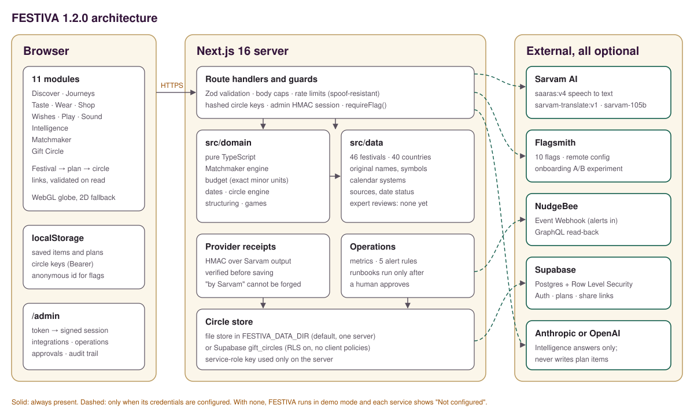

## New in 1.2

- **Matchmaker that knows how you celebrate**: religious, cultural or secular observance, and the ages coming (no alcohol suggested when under-18s attend; quiet time for under-fives; rites in the schedule when kept). Every change is explained in the plan.
- **One connected journey**: festival page → prefilled Matchmaker → plan → prefilled Gift Circle (festival, next date, currency, per-gift budget, group size, gift style). Link values are validated, never trusted.
- **15 researched festivals from underrepresented regions**: Meskel (Ethiopia), Homowo (Ghana), Vodun Days (Benin), Tweede Nuwe Jaar (South Africa), Loy Krathong (Thailand), Sinulog (Philippines), Thaipusam (Malaysia, Singapore, India), Garma (Australia), Merrie Monarch (Hawaiʻi), Sámi National Day (Sápmi, across Norway, Sweden, Finland and Russia), Candelaria (Peru), Guelaguetza (Mexico), Junkanoo (The Bahamas), Trinidad and Tobago Carnival, and Kandy Esala Perahera (Sri Lanka).
- **Cultural provenance on every festival page**: names in original scripts with language tags, symbols and meanings, how the date is set, which sections are documented history and which are belief, practice or guidance, each date's verification status with sources, and the expert-review status.
- **Integration evidence mode**: `npm run integrations:evidence` writes a redacted, timestamped report labelling every result LIVE SERVICE, LOCAL TEST DOUBLE, NOT CONFIGURED or LOCAL CHECK.
- **Trust**: spoof-resistant rate limits, caps on paid provider calls, a limit on guessing circle keys, and expanded privacy information on voice data and children, with a draft policy and legal questions for review.

## FESTIVA Gift Circle

*Bring everyone together. Understand every preference. Celebrate without the chaos.*

**The problem.** A family festival gift exchange is chaos when the people in it speak different languages, live in different cities and have different budgets: preferences get lost in translation, Secret Santa leaks, and nobody knows who has put in what.

**How it works.**

1. **Create**: the organiser picks the festival or occasion, dates, a total and per-gift budget, a gift style and a participant limit (guided steps or one page, decided by a Flagsmith experiment).
2. **Invite**: one private link, replaceable and revocable; the token travels after `#` so servers never log it.
3. **Speak**: each participant types or speaks their preference in their own language. Sarvam transcribes it (22 Indian languages and English), they correct it, and Sarvam can translate it for the organiser.
4. **Understand**: the original is always kept and shown first; the translation is stored beside it, labelled.
5. **Organise**: structured wishlist fields, wishlists, transparent gift ideas from FESTIVA's guide (each with reasons, no invented prices), a Secret Santa draw nobody can peek at, contribution commitments (FESTIVA never handles money) and budget insights that add up exactly.
6. **Control**: ten Flagsmith flags switch features on and off live, with validated remote configuration.
7. **Operate**: FESTIVA measures itself, raises alerts, sends them to NudgeBee, and proposes runbooks that run only after a human approves them.
8. **Complete**: a printable summary and a celebration plan from the Matchmaker.

| Sponsor | Role in FESTIVA |
| --- | --- |
| **Sarvam AI** | Makes it multilingual and accessible: speech-to-text (`saaras:v4`), translation (`sarvam-translate:v1`), preference structuring and grounded cultural suggestions (`sarvam-105b`) |
| **Flagsmith** | Makes it controllable, testable and safely releasable: feature flags enforced on the server, remote configuration, the onboarding A/B experiment |
| **NudgeBee** | Makes it observable and operationally intelligent: FESTIVA's alerts go to NudgeBee's Event Webhook for triage and investigation; runbooks are human-approved and audited |

Details: [docs/SPONSORS.md](docs/SPONSORS.md). Demo: [docs/DEMO.md](docs/DEMO.md).

### Architecture

```
Browser ──► Next.js route handlers ──► domain/circle (pure logic) ──► circle store (file │ Supabase, RLS)
   │             │  authorise (hashed keys) · requireFlag (server-side) · instrument (metrics)
   │             ├──► SarvamProvider ─────────────────────────────► Sarvam AI
   │             ├──► FlagsmithProvider (official SDK) ───────────► Flagsmith
   │             └──► alert rules ──► NudgeBeeIntegration ────────► NudgeBee Event Webhook / GraphQL
   └── /admin (token → signed session): integration status · experiment · operations · approvals · audit
Prometheus ◄── /api/ops/metrics            NudgeBee workflow ──► /api/ops/runbook-proposals (propose only)
```

More in [docs/ARCHITECTURE.md](docs/ARCHITECTURE.md#gift-circle-and-the-sponsor-integrations).

### Integration status

| Integration | Status | What was verified | What was not |
| --- | --- | --- | --- |
| Sarvam AI | **IMPLEMENTED, CREDENTIALS REQUIRED** | Provider unit tests (fake fetch); full voice journey end to end against a local test double | Any request to the real Sarvam API |
| Flagsmith | **IMPLEMENTED, CREDENTIALS REQUIRED** | Official SDK evaluating a real environment document; live flag flips with no redeploy against a test double; fallback when unreachable | A real Flagsmith project |
| NudgeBee | **IMPLEMENTED, INFRASTRUCTURE AND CREDENTIALS REQUIRED** | Real telemetry, alerts, controlled tests, approvals and audit; Event Webhook and GraphQL formats against a test double | A NudgeBee workspace; Kubernetes; NudgeBee's own investigation |
| Gift Circle product | **IMPLEMENTED AND VERIFIED** (demo mode, file store) | Unit, database and end-to-end tests, accessibility checks | Supabase circle store against a live project |

To verify live on your machine: fill `.env.local`, run `npm run integrations:evidence`, then open `/admin/integrations`. Step by step: [docs/SPONSOR_EVIDENCE.md](docs/SPONSOR_EVIDENCE.md).

### Gift Circle screenshots

Captured from the production build wired to the local test doubles (transcripts and translations here are canned test data, not Sarvam output):

| Landing | Voice transcript review | Phone |
| --- | --- | --- |
|  | 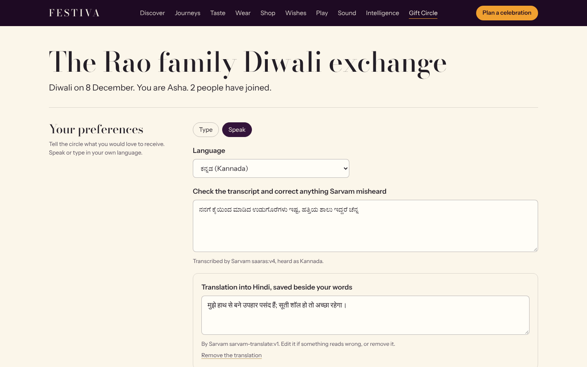 | 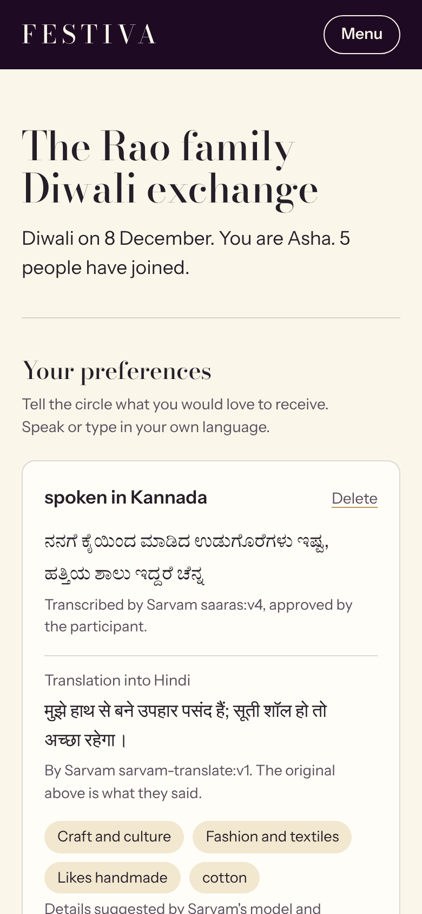 |

| Organiser | Operations centre |
| --- | --- |
| 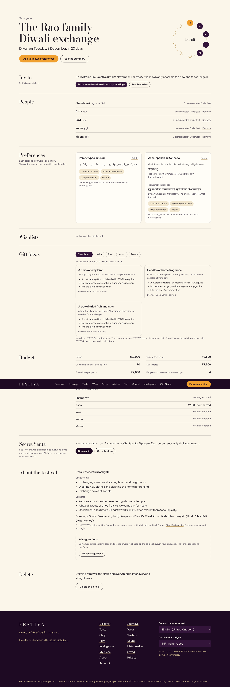 | 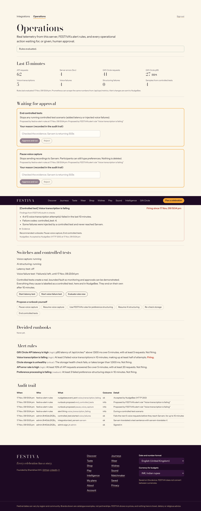 |

## Screenshots

Real captures from the production build, in `docs/screenshots/`:

| Homepage | Matchmaker plan | Phone |
| --- | --- | --- |
| 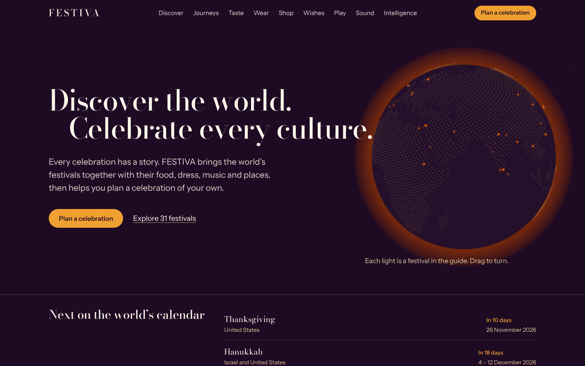 | 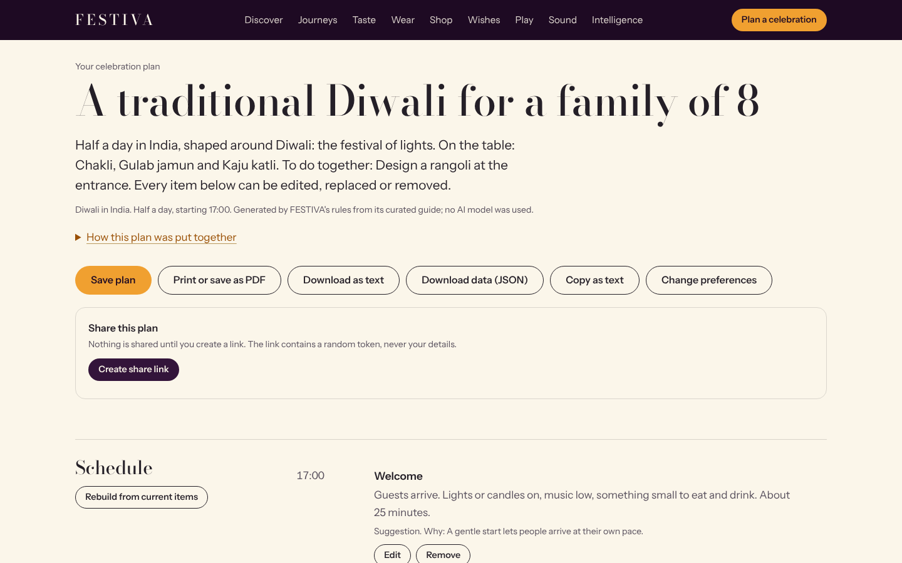 | 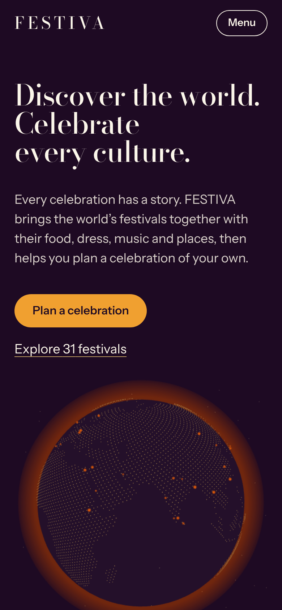 |

From the 1.1 visual pass (`docs/screenshots/visual/`, see [docs/VISUAL_SYSTEM.md](docs/VISUAL_SYSTEM.md)):

| Journeys | Taste | Play |
| --- | --- | --- |
| 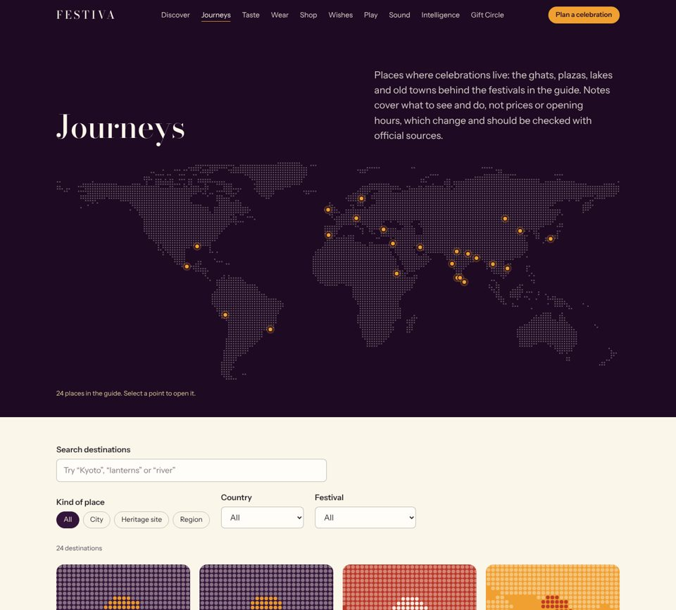 | 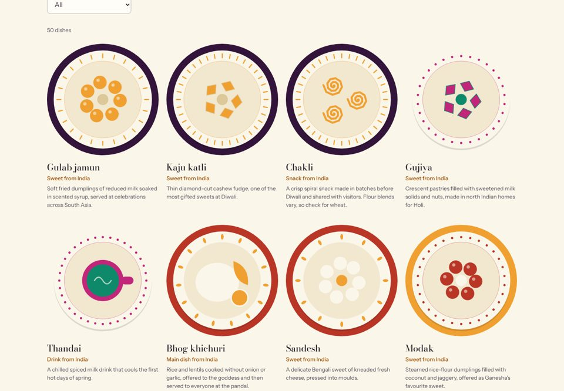 | 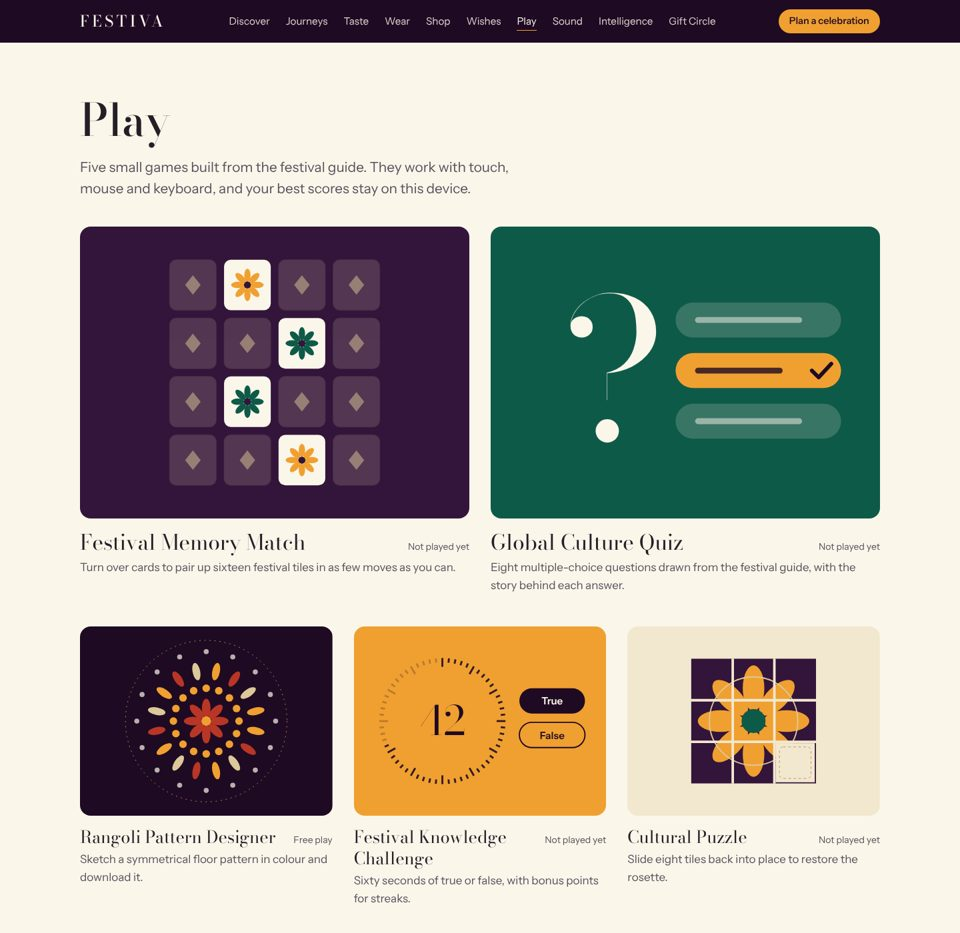 |

| The year at a glance | Gift Circle budget | Secret Santa on a phone |
| --- | --- | --- |
| 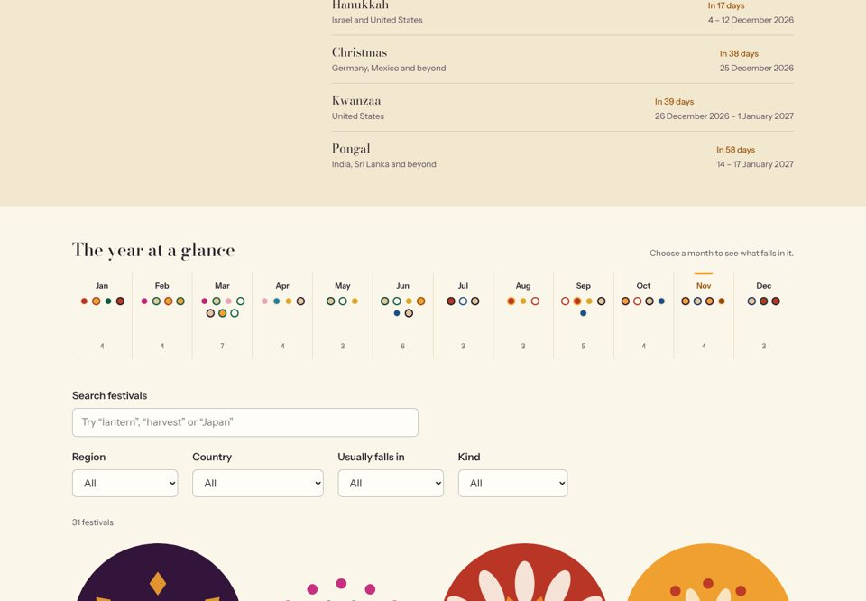 | 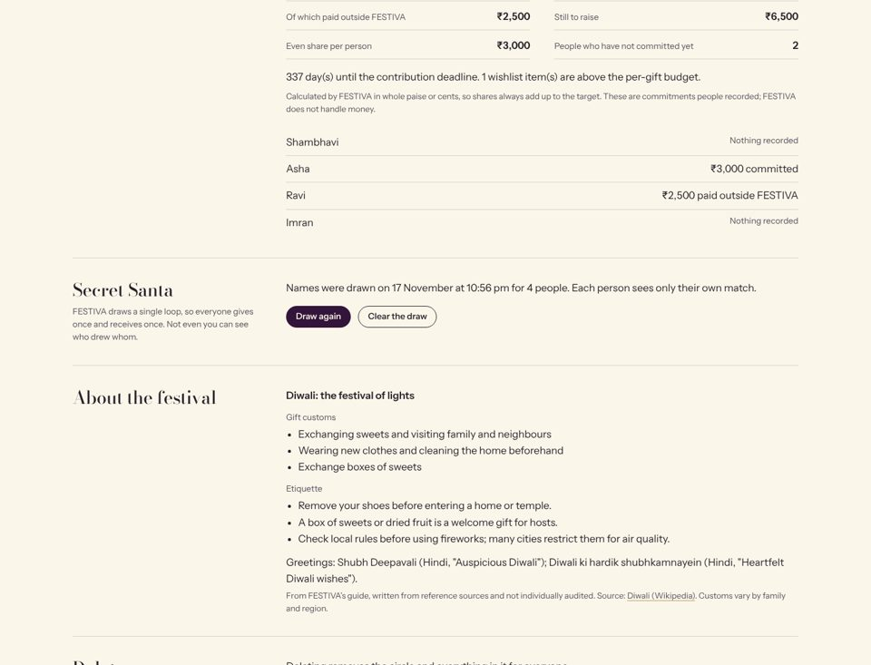 | 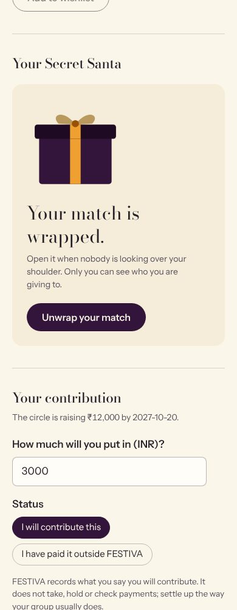 |

## Run it

```bash
npm ci
npm run dev            # development, http://localhost:3000
npm run build && npm run start   # production build, faster
```

No environment variables are needed. With none set, FESTIVA runs in demo mode and says so in the interface: saved items and plans stay in the browser, share links are held in server memory, the Matchmaker and the assistant use FESTIVA's own rules, Gift Circle works with typing only and flag defaults, and the admin pages are closed.

To switch on integrations, copy `.env.example` to `.env.local`. Every variable is documented there and in [docs/SPONSORS.md](docs/SPONSORS.md) (where it comes from, whether it is secret, how to test, rotate and disable it). The most useful:

| Variable | Secret | Enables |
| --- | --- | --- |
| `FESTIVA_ADMIN_TOKEN` | yes | `/admin/integrations` and `/admin/operations` |
| `SARVAM_API_KEY` | yes | Voice, translation, AI structuring and cultural suggestions |
| `FLAGSMITH_ENVIRONMENT_KEY` (`ser.…`) | yes | Live feature flags, remote configuration, experiment assignment |
| `NUDGEBEE_EVENT_WEBHOOK_URL`, `NUDGEBEE_EVENT_WEBHOOK_TOKEN` | token yes | Alerts sent to NudgeBee |
| `FESTIVA_METRICS_TOKEN` | yes | Prometheus scraping of `/api/ops/metrics` |
| `FESTIVA_DATA_DIR` | no | Where Gift Circle data and operations records are kept |

## Database setup

Demo mode needs no database. Gift Circles are stored as files in `FESTIVA_DATA_DIR` (default `.festiva-data/`), which suits one server.

For Supabase, apply both migrations in `supabase/migrations/` (the core schema and `…_gift_circles.sql`), then the seed, as in [docs/DEPLOYMENT.md](docs/DEPLOYMENT.md). To keep circles in Supabase, set `FESTIVA_CIRCLE_STORE=supabase` and the server-only `SUPABASE_SERVICE_ROLE_KEY`; the `gift_circles` table has RLS enabled and no client policies, so browsers cannot read it. `npm run db:verify` checks all of this on a real Postgres engine.

## Demo

[docs/DEMO.md](docs/DEMO.md) is a step-by-step judge script with expected results, for a live setup or for a rehearsal against the labelled local test doubles (`npm run stubs`).

## Security

- Sponsor keys and admin tokens are server-only, validated at startup, never sent to the browser and never logged; an end-to-end test checks browser bundles for secret names.
- Circle access uses per-circle keys stored only as SHA-256 hashes; Secret Santa pairs are never sent to the organiser.
- Admin sessions are HMAC-signed, HttpOnly, SameSite=Strict cookies; admin writes must be same-origin.
- Audio is validated by its bytes and size, sent to Sarvam only after consent, and never stored. The microphone permission is granted to this site only.
- Expensive endpoints are rate-limited by participant and by client address; forged `X-Forwarded-For` headers cannot mint fresh limits; paid provider calls are capped per hour; failed circle-key guesses are limited. Logs and metrics contain no personal content.
- Production dependencies: `npm audit --omit=dev` reports 0 known vulnerabilities (18 November 2026).
- No operational action runs without an administrator's explicit approval, and every step is audited.

## What is in the product

| Module | Route | What works |
| --- | --- | --- |
| Home | `/` | Interactive WebGL globe with 2D and no-JS fallbacks, upcoming festivals computed from today's date, a real sample plan from the engine |
| Discover | `/discover`, `/discover/[slug]`, `/discover/calendar` | 46 festivals in 40 countries; search; region, country, month and kind filters; original names, symbols, calendar system; history, significance, traditions, regional variations, etiquette, greetings, each labelled by kind of claim; next date with its verification status and sources; expert-review status; save; plan with the Matchmaker |
| Journeys | `/journeys`, `/journeys/[slug]`, `/journeys/country/[code]` | 35 destinations, 40 country pages, landmarks, experiences, cultural itineraries, OpenStreetMap links |
| Taste | `/taste`, `/taste/[slug]` | 51 dishes, ingredients, background, dietary filters and notes |
| Wear | `/wear`, `/wear/[slug]` | 18 entries: textiles, craftsmanship, respectful wearing, contemporary interpretations, designers |
| Shop | `/shop`, `/shop/[slug]` | Gift ideas by tier, category and recipient; 14 brand profiles with official links; wishlist; budget hand-off to the Matchmaker. No prices, ratings or partnerships |
| Wishes | `/wishes` | Greeting card studio: festival, traditional greeting, recipient, language, tone, layout, typeface, colours, live preview, PNG export, copy, share |
| Play | `/play`, `/play/[game]` | Memory Match, Culture Quiz, Rangoli Designer, Knowledge Challenge, Cultural Puzzle, with scoring, reset, completion, best scores, touch and keyboard |
| Sound | `/sound` | 16 genres, 49 artists; search by artist, song, country, language; curated playlists; favourites; recently explored; links to licensed services |
| Intelligence | `/intelligence` | Grounded cultural assistant that separates facts from suggestions and lists sources; optional AI provider |
| **Matchmaker** | `/matchmaker`, `/plans`, `/share/[token]` | Six-step concierge with live preview; observance (religious, cultural, secular) and ages coming; plan with schedule, food, gifts, attire, decorations, activities, music, greetings, destinations, cultural context and budget; edit, replace, remove, regenerate; save; export (print/PDF, text, JSON); share and revoke; start a Gift Circle from the plan |
| Account | `/account` | Supabase Auth sign-in when configured; a plain explanation when not |
| **Gift Circle** | `/circles`, `/circles/new`, `/circles/join`, `/circles/[id]`, `/circles/[id]/me`, `/circles/[id]/summary` | Group gift exchange: create (A/B onboarding), invite, join, typed or spoken preferences in 27 languages, transcript review, translation kept apart from the original, structured wishlists, gift ideas, Secret Santa, contributions, budget insights, cultural context, summary |
| Admin | `/admin`, `/admin/integrations`, `/admin/operations` | Sponsor status from real requests, connection tests, flags, remote config, experiment results, telemetry, alerts, approvals, controlled tests, audit trail |

## Checks

```bash
npm run lint               # ESLint
npm run typecheck          # route types + TypeScript
npm test                   # 170 unit tests (Jest)
npm run db:verify          # 40 checks: migrations, seed and Row Level Security on a real Postgres engine (PGlite)
npm run test:e2e           # 84 end-to-end tests (desktop and phone) against the production build, demo mode (Playwright)
npm run test:integrations  # 7 end-to-end tests of the sponsor code paths against local test doubles
npm run test:all           # all of the above
npm run integrations:evidence  # live check of Sarvam, Flagsmith and NudgeBee with your credentials, with a report
npm run perf               # lab performance measurements (needs a running server)
npm run package            # release ZIP (needs bash and zip)
```

End-to-end tests need a browser: run `npx playwright install chromium` once, or set `PLAYWRIGHT_CHANNEL=chrome` to use an installed Google Chrome. Results, with what each number does and does not prove: [docs/TESTING.md](docs/TESTING.md).

## Project structure

```
src/
  app/                 Routes (App Router), API route handlers, sitemap, robots, manifest, social image
  components/          UI: Header, Globe, CatalogExplorer, matchmaker/, play/, WishStudio, Chat, …
  data/                Curated dataset (festivals, food, attire, destinations, shop, music, quiz)
  domain/              Framework-free logic: dates, budget, matchmaker engine, search, games, wishes
  lib/                 Platform: env validation, AI providers and guard, sharing, storage, analytics
  proxy.ts             Real 404s for unknown catalogue slugs
supabase/
  migrations/          Schema, constraints, triggers, RLS policies
  seed.sql             Generated from src/data (npm run db:seed:generate)
scripts/               Seed generator, database verifier, globe data, performance, packaging
tests/unit/            Jest
tests/e2e/             Playwright (desktop and mobile projects), demo mode
tests/e2e-integrations/ Playwright against local test doubles (tests/stubs/provider-stubs.mjs)
ops/                   Prometheus scrape config and alert rules, Alertmanager → NudgeBee, Kubernetes manifest (untested)
docs/                  Architecture, deployment, testing, performance, provenance, limitations, handover
```

## Documentation

**Start here**
- [docs/WINDOWS_SETUP.md](docs/WINDOWS_SETUP.md): Windows 11 and VS Code, from nothing to running
- [docs/DEMO_3_MINUTES.md](docs/DEMO_3_MINUTES.md): three-minute hackathon demo; [docs/DEMO.md](docs/DEMO.md): full ten-minute judge walkthrough
- [docs/SPONSOR_EVIDENCE.md](docs/SPONSOR_EVIDENCE.md): connect Sarvam AI, Flagsmith and NudgeBee and produce evidence
- [docs/DEPLOYMENT.md](docs/DEPLOYMENT.md): Vercel and Supabase
- [docs/TESTING.md](docs/TESTING.md): testing and verification report
- [docs/KNOWN_LIMITATIONS.md](docs/KNOWN_LIMITATIONS.md): what is not done, and what is blocked
- [CHANGELOG.md](CHANGELOG.md)

**Design and engineering**
- [docs/ARCHITECTURE.md](docs/ARCHITECTURE.md) (with [diagram](docs/architecture.svg))
- [docs/SPONSORS.md](docs/SPONSORS.md): how each sponsor is used, credentials, rotation
- [docs/RUNBOOKS.md](docs/RUNBOOKS.md), [docs/NUDGEBEE_DEMO.md](docs/NUDGEBEE_DEMO.md)
- [docs/PERFORMANCE.md](docs/PERFORMANCE.md), [docs/VISUAL_SYSTEM.md](docs/VISUAL_SYSTEM.md), [docs/MOBILE.md](docs/MOBILE.md)

**Content, privacy and review**
- [docs/DATA_PROVENANCE.md](docs/DATA_PROVENANCE.md), [docs/CONTENT_REVIEW.md](docs/CONTENT_REVIEW.md)
- [docs/PRIVACY_POLICY_DRAFT.md](docs/PRIVACY_POLICY_DRAFT.md), [docs/LEGAL_REVIEW.md](docs/LEGAL_REVIEW.md)
- [docs/THIRD_PARTY.md](docs/THIRD_PARTY.md), [docs/HANDOVER.md](docs/HANDOVER.md)

## Licence

No licence file has been added. Until the founder chooses one, the code and content are not licensed for reuse. Third-party components keep their own licences; see [docs/THIRD_PARTY.md](docs/THIRD_PARTY.md).
