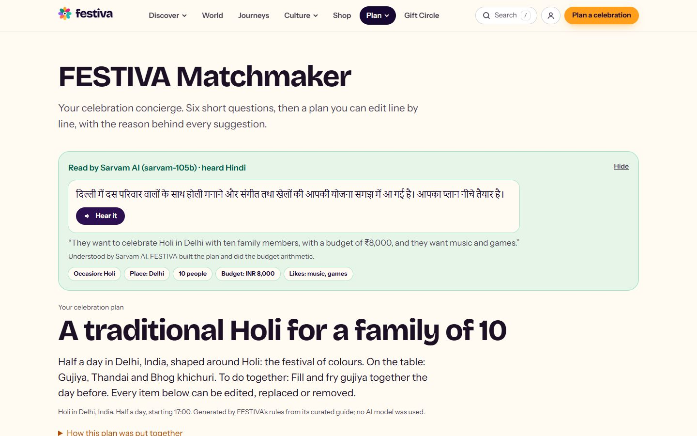
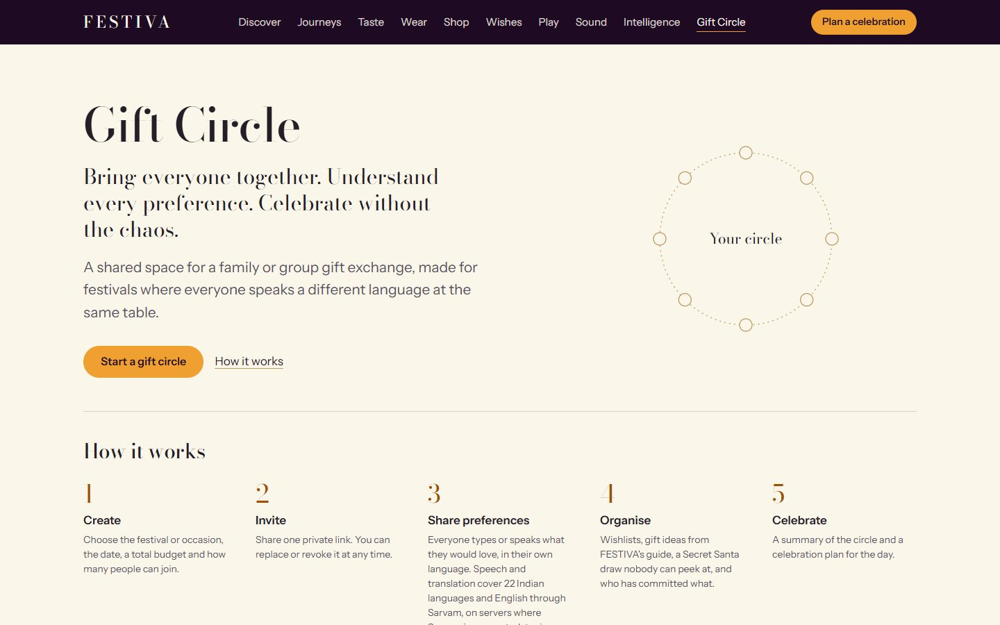
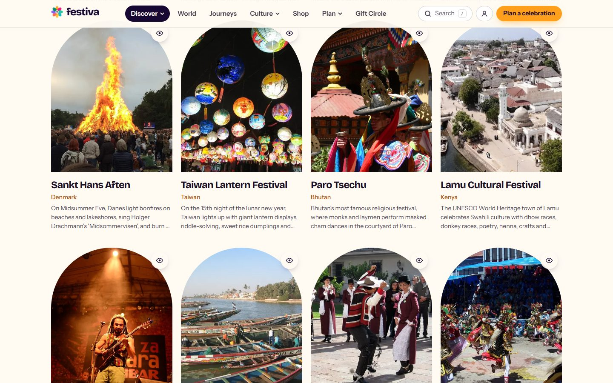
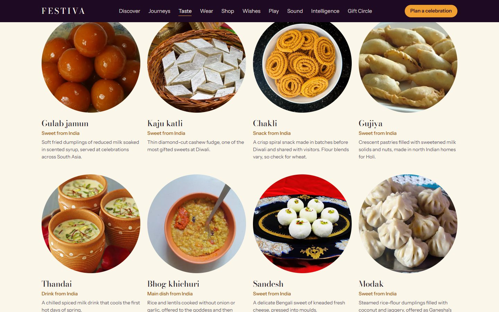
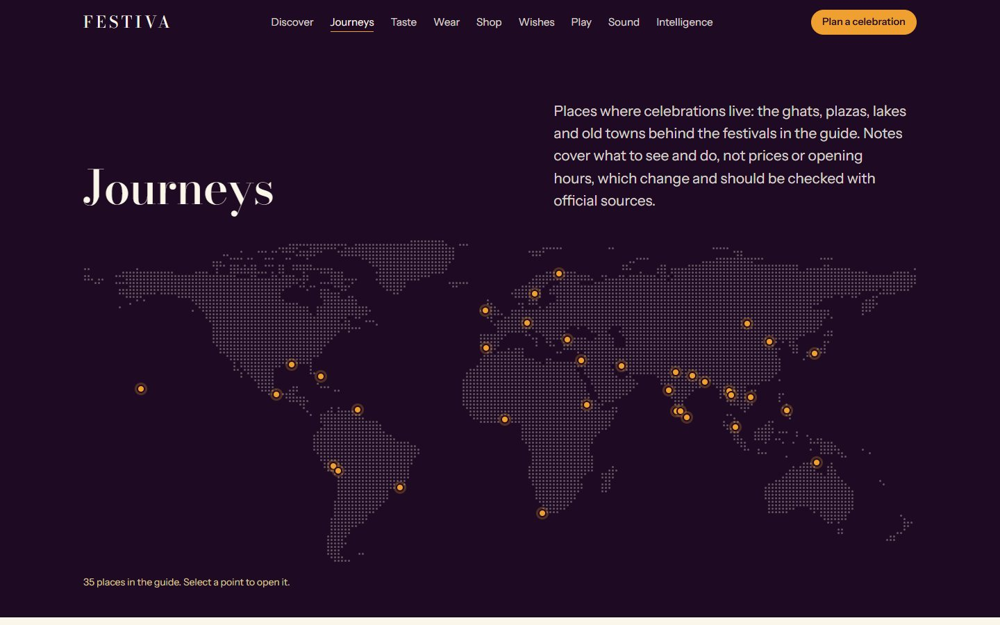

<div align="center">

# FESTIVA

**Global festival discovery and AI-assisted celebration planning.**

[Live demo](https://festiva-eta.vercel.app) 


</div>

## Overview

FESTIVA covers 175 festivals across 195 countries (every UN member state except Paraguay, plus Vatican City, Palestine and Taiwan): history, traditions, food, dress, music and destinations, with a sourced next date for every movable festival. A deterministic **Matchmaker** turns six answers into a complete celebration plan, and **Gift Circle** lets a group organise a gift exchange across languages, by voice or text.

## What it does for users

| Need | How FESTIVA solves it |
|---|---|
| **Understand a celebration** | Each festival page explains meaning, history, regional variations and etiquette, and gives the next date with its source and how certain it is. |
| **Plan one, fast** | Describe the celebration in your own words, in English or an Indian language ("Diwali with six friends in Bengaluru, ₹5,000, two days"), and Sarvam AI reads it; or answer six questions. Either way you get an editable plan: schedule, food, gifts, attire, décor, music and greetings, with a budget that FESTIVA's code always adds up. |
| **Eat right** | Every dish lists vegetarian and vegan status and common allergens, and plans respect dietary needs. |
| **Gift as a group** | Gift Circle collects everyone's wishes by voice or text in their own language, translates them, suggests gifts, draws Secret Santa and tracks who has contributed. |
| **Explore the world** | A real, zoomable map on Natural Earth boundaries (India point of view). Open any country to see its festivals; open India to go state by state through all 28 states and 8 union territories. Deep links (`/world?country=IN&region=IN-KL`) are shareable. |
| **Find anything** | Global search (press `/`) across festivals, countries, India's states, food, attire, places, brands and artists, with keyboard navigation. |
| **Travel** | Cities and heritage sites where festivals come alive, with landmarks, experiences and a short itinerary for each. |
| **Share and keep** | Save plans, export them as text, JSON or PDF, share a link and revoke it later. Greeting cards download as images. |

## Screenshots

<table>
  <tr>
    <td width="50%"><br /><sub><b>Home:</b> a WebGL globe of festival lights</sub></td>
    <td width="50%"><br /><sub><b>Festival page:</b> meaning, sourced next date and a one-click plan</sub></td>
  </tr>
  <tr>
    <td><br /><sub><b>Matchmaker:</b> six questions with a live plan preview</sub></td>
    <td><br /><sub><b>Gift Circle:</b> multilingual group gifting powered by Sarvam AI</sub></td>
  </tr>
  <tr>
    <td><br /><sub><b>Discover:</b> 175 festivals with search and filters</sub></td>
    <td><br /><sub><b>Taste:</b> festival dishes with diet and allergen notes</sub></td>
  </tr>
  <tr>
    <td><br /><sub><b>Journeys:</b> an interactive map of festival destinations</sub></td>
    <td align="center"><br /><sub><b>Mobile:</b> fully responsive</sub></td>
  </tr>
</table>

## Sponsor integrations, verified live

| | Integration | Verified |
|---|---|---|
| **Sarvam AI** | FESTIVA Intelligence and the natural-language planner brief (`sarvam-105b`, JSON schema, any supported Indian language), speech-to-text (`saaras:v4`), translation (`sarvam-translate:v1`), structured preference extraction. Every AI-derived field carries an HMAC-signed provenance receipt, verified on the server. | Live |
| **Flagsmith** | Official server SDK with local evaluation. Ten flags enforced in both UI and API, validated remote config, and a multivariate onboarding experiment. No redeploy needed for any change. | Live |
| **NudgeBee** | Five alert rules over real telemetry, delivered to NudgeBee's Event Webhook. Runbooks are approval-gated, reversible and audited. Runs on a self-hosted Community install (Helm on k3s). | Live |


## Engineering

- **Architecture:** Next.js 16 App Router with Cache Components and partial prerendering (675 static pages). Pure domain logic sits in `src/domain`, curated data in `src/data`, and integrations are isolated in `src/lib/integrations`.
- **Correctness:** budget arithmetic in integer minor units; no model ever computes a total. Zod 4 validates every input and environment variable.
- **Security:** strict CSP and security headers, server-only secrets, spoof-resistant rate limiting, signed admin sessions, and Row Level Security on all 30 Supabase tables.
- **Resilience:** every external service has an honest fallback, so the app runs fully with zero configuration.
- **Frontend:** React 19, Tailwind CSS 4, a WebGL globe (Three.js and GLSL) with 2D fallback, view transitions, and accessibility tested with axe-core.

## Quick start

```bash
npm ci
npm run dev            # http://localhost:3000
```


## Quality

```bash
npm run lint && npm run typecheck   # ESLint, strict TypeScript
npm test                            # 455 unit tests
npm run db:verify                   # migrations and RLS on embedded Postgres
npm run test:e2e                    # Playwright end-to-end and accessibility
```

## Documentation

[Architecture](docs/ARCHITECTURE.md) · [Deployment](docs/DEPLOYMENT.md) · [Sponsors](docs/SPONSORS.md) · [Testing](docs/TESTING.md) · [Demo script](docs/DEMO_3_MINUTES.md) · [Known limitations](docs/KNOWN_LIMITATIONS.md)


---

<div align="center">

Built by **Shambhavi * · [GitHub](https://github.com/ShambhaviCode) · MIT License

</div>
