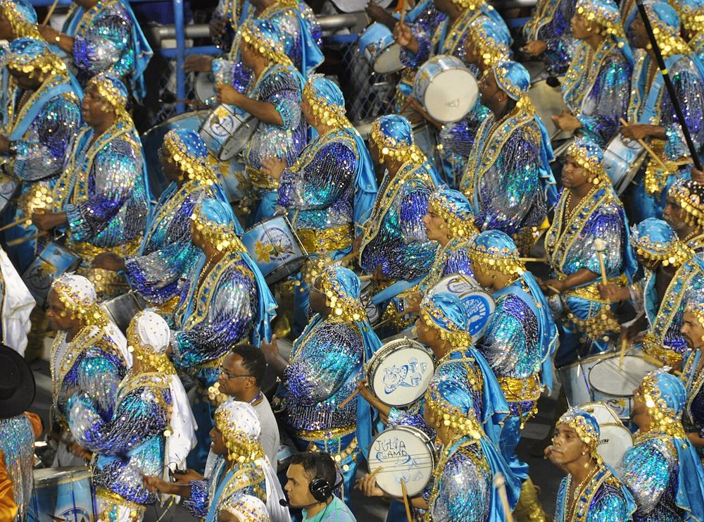

<div align="center">

# FESTIVA

**Global festival discovery and AI-assisted celebration planning.**

[Live demo](https://festiva-eta.vercel.app) · [Architecture](docs/ARCHITECTURE.md) · [Sponsor evidence](docs/evidence/integration-evidence-2026-11-21-live.md)


   

</div>

## Overview

FESTIVA covers 46 festivals across 40 countries: history, traditions, food, dress, music and destinations, with a sourced next date for every movable festival. A deterministic **Matchmaker** turns six answers into a complete celebration plan, and **Gift Circle** lets a group organise a gift exchange across languages, by voice or text.

## Sponsor integrations, verified live

| | Integration | Verified |
|---|---|---|
| **Sarvam AI** | Speech-to-text (`saaras:v4`), translation (`sarvam-translate:v1`), structured preference extraction (`sarvam-105b`, JSON schema). Every AI-derived field carries an HMAC-signed provenance receipt, verified on the server. | Live |
| **Flagsmith** | Official server SDK with local evaluation. Ten flags enforced in both UI and API, validated remote config, and a multivariate onboarding experiment. No redeploy needed for any change. | Live |
| **NudgeBee** | Five alert rules over real telemetry, delivered to NudgeBee's Event Webhook. Runbooks are approval-gated, reversible and audited. Runs on a self-hosted Community install (Helm on k3s). | Live |

Request IDs and results: [evidence report](docs/evidence/integration-evidence-2026-11-21-live.md).

## Engineering

- **Architecture:** Next.js 16 App Router with Cache Components and partial prerendering (264 static pages). Pure domain logic sits in `src/domain`, curated data in `src/data`, and integrations are isolated in `src/lib/integrations`.
- **Correctness:** budget arithmetic in integer minor units; no model ever computes a total. Zod 4 validates every input and environment variable.
- **Security:** strict CSP and security headers, server-only secrets, spoof-resistant rate limiting, signed admin sessions, and Row Level Security on all 30 Supabase tables.
- **Resilience:** every external service has an honest fallback, so the app runs fully with zero configuration.
- **Frontend:** React 19, Tailwind CSS 4, a WebGL globe (Three.js and GLSL) with 2D fallback, view transitions, and accessibility tested with axe-core.

## Quick start

```bash
npm ci
npm run dev            # http://localhost:3000
```

No environment variables are required. To enable the integrations, copy [`.env.example`](.env.example) to `.env.local`.

## Quality

```bash
npm run lint && npm run typecheck   # ESLint, strict TypeScript
npm test                            # 288 unit tests
npm run db:verify                   # migrations and RLS on embedded Postgres
npm run test:e2e                    # Playwright end-to-end and accessibility
```

## Documentation

[Architecture](docs/ARCHITECTURE.md) · [Deployment](docs/DEPLOYMENT.md) · [Sponsors](docs/SPONSORS.md) · [Testing](docs/TESTING.md) · [Demo script](docs/DEMO_3_MINUTES.md) · [Known limitations](docs/KNOWN_LIMITATIONS.md)

## Credits

Photographs: Wikimedia Commons under free licences, each credited on its page and in [`src/data/photos.ts`](src/data/photos.ts). All other artwork is generated in code.

---

<div align="center">

Built by **Shambhavi M K** · [GitHub](https://github.com/ShambhaviCode) · MIT License

</div>
