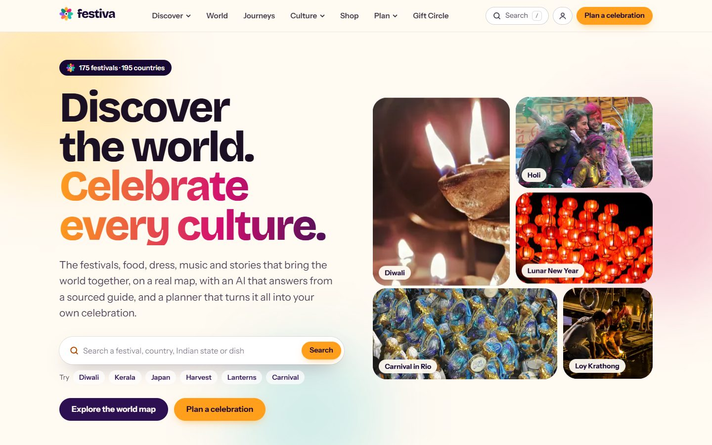
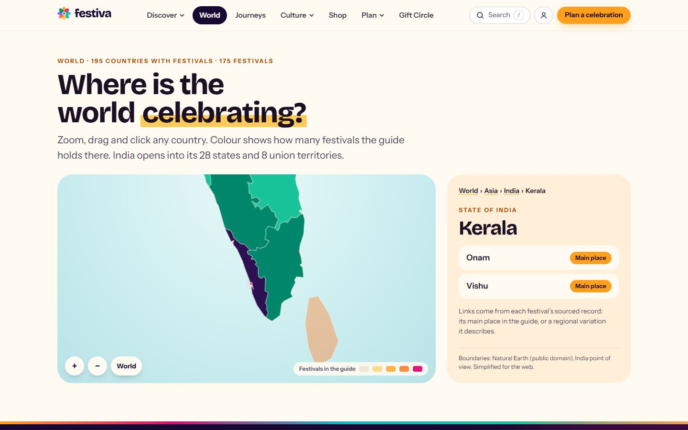
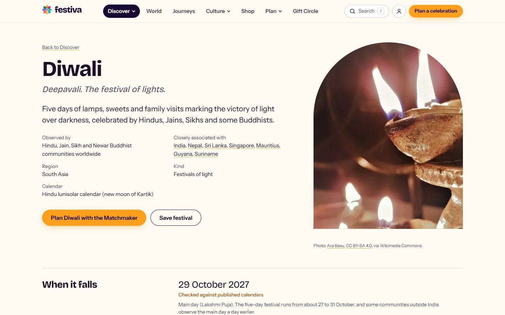
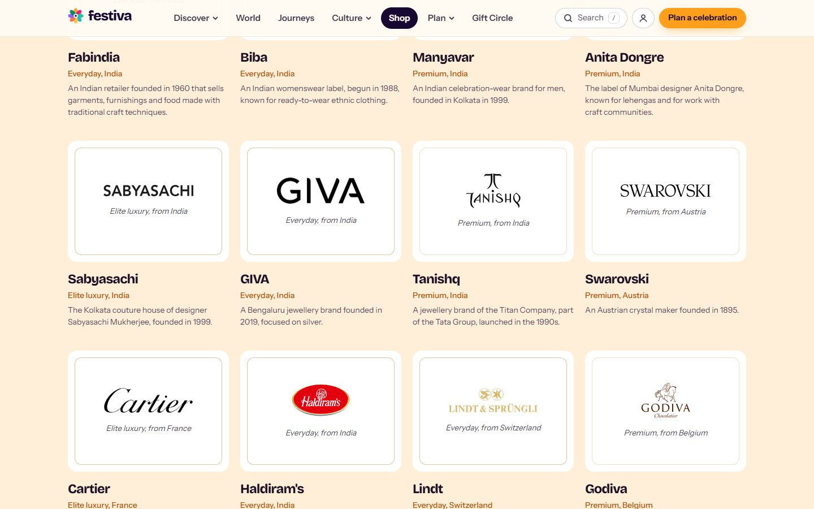
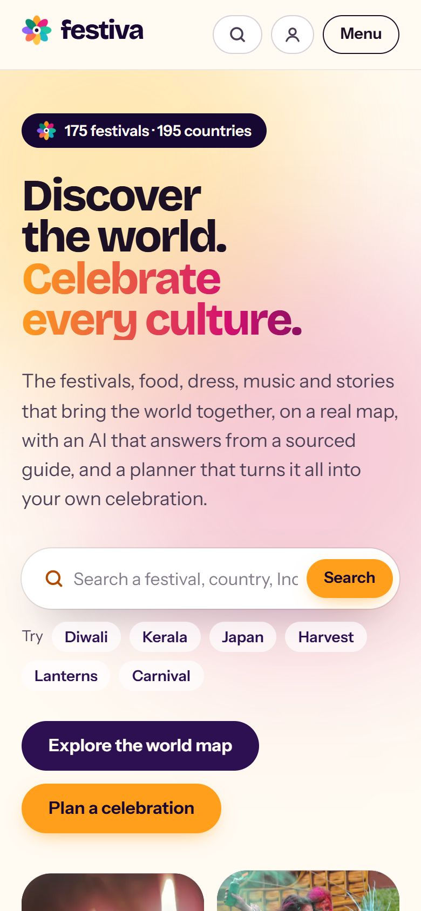
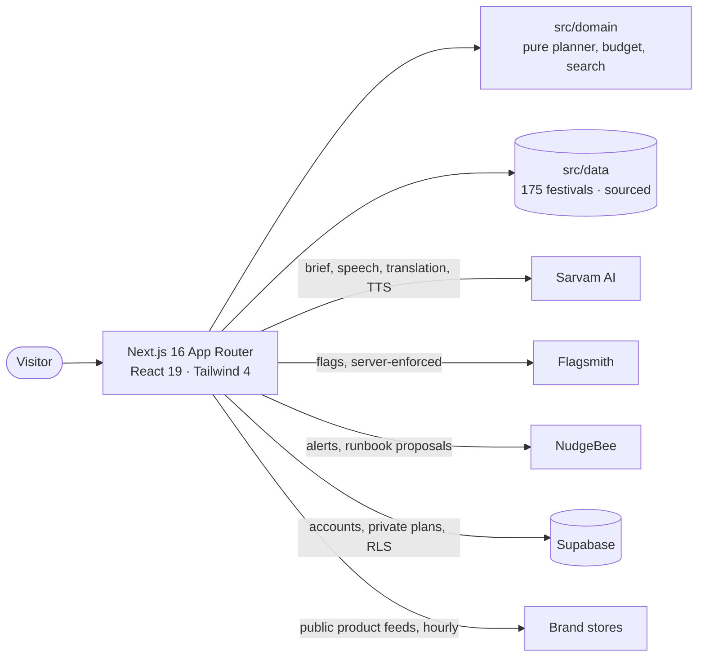

<div align="center">


# festiva

### Discover the world. Celebrate every culture.

**Plan any celebration by simply describing it, in English or an Indian language, and hear FESTIVA answer back in yours.**

[**Open the live app →**](https://festiva-eta.vercel.app) &nbsp;·&nbsp; [Demo script](docs/DEMO_3_MINUTES.md) &nbsp;·&nbsp; [Architecture](docs/ARCHITECTURE.md) &nbsp;·&nbsp; [Sponsor evidence](docs/SPONSOR_EVIDENCE.md)


<sub>Built for <b>Festive Hacks</b> by WeMakeDevs × WeAreDevelopers · 25 November 2026 · Bengaluru</sub>

<br />



</div>

---

## The problem

Festival season is the busiest time of the year, and planning it is still a mess of WhatsApp threads, spreadsheets and guesswork. Who is coming, what to cook for a vegetarian aunt, what to wear, what to gift on a ₹5,000 budget, what the festival even means. And the tools that could help start with an English text box, so the person who would rather just *say* "दिल्ली में परिवार के दस लोगों के साथ होली मनानी है" has to translate their own life first.

## What FESTIVA does

**Describe the celebration the way you would to a friend. FESTIVA understands it, plans it, and answers you out loud in your own language.**

| | |
|---|---|
| 🗣️ **Voice in, voice out** | Type or speak a brief in Hindi, Kannada, Tamil or any of 22 Indian languages. **Sarvam AI** reads it, FESTIVA builds the plan, and replies in *your* language and script, then reads that reply aloud. |
| 🧮 **A plan you can trust** | Schedule, food for every diet, gifts, dress, décor, music and greetings, all editable. The **budget always adds up**, because the arithmetic runs in code with integer paise, never in an AI model. |
| 🎁 **Gift Circle** | Organise a family gift exchange across languages: everyone records or types their wishes, Sarvam transcribes and translates them, FESTIVA suggests gifts and draws Secret Santa. |
| 🗺️ **Explore the world** | A real zoomable map on Natural Earth boundaries. Open any country, or go state by state through all **28 states and 8 union territories** of India. |
| 🛍️ **Shop real products** | Live products and prices straight from Fabindia, GIVA, Nicobar and Godiva's own stores, refreshed hourly, plus curated gift ideas for 14 brands. |
| 🌍 **Understand every festival** | **175 festivals across 195 countries**: history, meaning, etiquette, regional variations and a **sourced** next date for every movable festival. |
| 🍛 **Eat right** | 66 festival dishes, **all vegetarian**, with vegan and allergen notes. |

<table>
  <tr>
    <td width="50%"><br /><sub><b>Planner:</b> a Hindi brief, read by Sarvam AI, answered in Hindi with <b>Hear it</b></sub></td>
    <td width="50%"><br /><sub><b>World:</b> India down to every state; here, Kerala and Onam</sub></td>
  </tr>
  <tr>
    <td><br /><sub><b>Festival guide:</b> meaning, traditions and a sourced next date</sub></td>
    <td><br /><sub><b>Shop:</b> brand logos, live products and Search Amazon links</sub></td>
  </tr>
  <tr>
    <td><br /><sub><b>Discover:</b> 175 festivals, Quick look side panel, filters by month and region</sub></td>
    <td><br /><sub><b>Gift Circle:</b> multilingual group gifting by voice or text</sub></td>
  </tr>
  <tr>
    <td><br /><sub><b>Taste:</b> vegetarian festival dishes with real photos</sub></td>
    <td align="center"><br /><sub><b>Mobile:</b> designed for phones first, with bottom sheets</sub></td>
  </tr>
</table>

## Try it in 60 seconds (for judges)

1. Open **[festiva-eta.vercel.app/matchmaker](https://festiva-eta.vercel.app/matchmaker)** and tap the **हिन्दी** or **ಕನ್ನಡ** example.
2. Watch the banner: **"Read by Sarvam AI · heard Hindi"**, a reply in Devanagari, and the plan below it. Press **Hear it**.
3. Change the budget and watch every line re-balance. It always adds up.
4. Press **/** anywhere and search "karna": Karnataka opens on the map.
5. Open **[/shop](https://festiva-eta.vercel.app/shop#live)**: live Fabindia, GIVA, Nicobar and Godiva products with real prices.
6. In Flagsmith, switch off `gift_circle_enabled`: about 15 seconds later Gift Circle disappears from the menu, and its API answers 403.

## How all three sponsors are used

Every one is load-bearing: switch any of them off and a real feature changes, honestly and visibly.

### Sarvam AI: the multilingual voice of FESTIVA

| Capability | Model | Where |
|---|---|---|
| Understand a celebration brief in any of 22 Indian languages and extract structured answers with a strict JSON schema | `sarvam-105b` | Planner |
| Reply in the person's own language and script | `sarvam-105b` | Planner |
| **Read the reply aloud** in 11 languages | `bulbul:v3` | Planner, Ask FESTIVA |
| Speech to text with automatic language detection | `saaras:v4` | Gift Circle voice wishes |
| Translate wishes between Indian languages and English | `sarvam-translate:v1` | Gift Circle |
| Grounded answers about festivals | `sarvam-105b` | Ask FESTIVA |

The detected language is always shown back ("heard Hindi") and transcripts are reviewed before they are saved, because a confident guess is not proof. Every AI-derived field carries a signed provenance receipt checked on the server.

### Flagsmith: real feature control, enforced on the server

Ten flags gate real behaviour in the UI **and** the API (a switched-off feature answers 403, it does not just hide a button), plus validated remote config and a multivariate onboarding experiment. Evaluated live with the official server SDK in local-evaluation mode, so a change applies in about 15 seconds with no redeploy.

### NudgeBee: safe, approval-gated operations

Five alert rules run on FESTIVA's real telemetry (API latency, error rate, voice failures, storage health, AI processing) and fire to NudgeBee's Event Webhook. Each alert proposes a runbook, such as **Pause voice capture**, that a human must approve with a reason; every runbook is reversible and written to an audit trail. A NudgeBee workflow can *propose* a runbook but can never run one. Verified live against a self-hosted NudgeBee Community install.

## Architecture



- **One rule above all:** no model ever computes a total. Budgets use integer minor units in `src/domain/budget.ts`.
- **Honest by design:** no invented prices, ratings, dates or partnerships. Movable dates cite their source; product prices come only from the brand's own store.
- **Runs with zero configuration:** every integration has a truthful fallback, so the app works fully with no keys at all.
- **Security:** strict CSP, server-only secrets, rate limiting, signed admin sessions, Row Level Security on every Supabase table.
- **Accessible:** keyboard menus and search, focus-trapped dialogs and bottom sheets, reduced-motion support, axe-core checks.

## Run it locally

```bash
git clone https://github.com/ShambhaviCode/Festiva.git
cd Festiva
npm ci
npm run dev          # http://localhost:3000, works with no keys
```

Add any of these to `.env.local` to switch on the real services (see `.env.example`):

| Variable | Turns on |
|---|---|
| `SARVAM_API_KEY` | Multilingual briefs, spoken replies, voice wishes, translation |
| `FLAGSMITH_ENVIRONMENT_KEY` | Live feature flags and the onboarding experiment |
| `NUDGEBEE_EVENT_WEBHOOK_URL`, `NUDGEBEE_EVENT_WEBHOOK_TOKEN` | Alerts to NudgeBee |
| `NEXT_PUBLIC_SUPABASE_URL`, `NEXT_PUBLIC_SUPABASE_ANON_KEY` | Sign-in and private cloud plans (run `supabase/migrations` first) |
| `AMAZON_ASSOCIATE_TAG` | Affiliate tag on Search Amazon links |

## Quality

```bash
npm run lint && npm run typecheck   # ESLint and strict TypeScript
npm test                            # 582 unit tests
npm run db:verify                   # migrations and Row Level Security on embedded Postgres
npm run test:e2e                    # Playwright end-to-end and accessibility
```

## Documentation

[Architecture](docs/ARCHITECTURE.md) · [Sponsors](docs/SPONSORS.md) · [Sponsor evidence](docs/SPONSOR_EVIDENCE.md) · [Deployment](docs/DEPLOYMENT.md) · [Testing](docs/TESTING.md) · [Demo script](docs/DEMO_3_MINUTES.md) · [Known limitations](docs/KNOWN_LIMITATIONS.md) · [Third-party credits](docs/THIRD_PARTY.md)

Photographs are from Wikimedia Commons under free licences, credited on each page. Brand logos identify the brands only; FESTIVA has no partnership with any of them.

---

<div align="center">

Built with care by **Shambhavi M K** · [GitHub](https://github.com/ShambhaviCode) · MIT License

</div>
