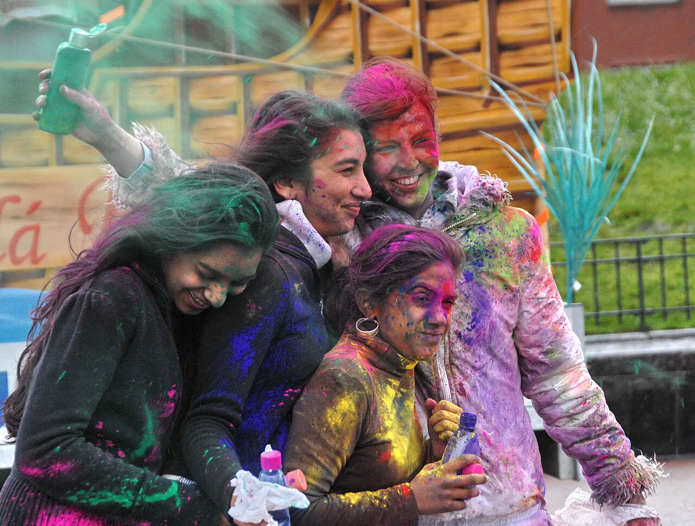
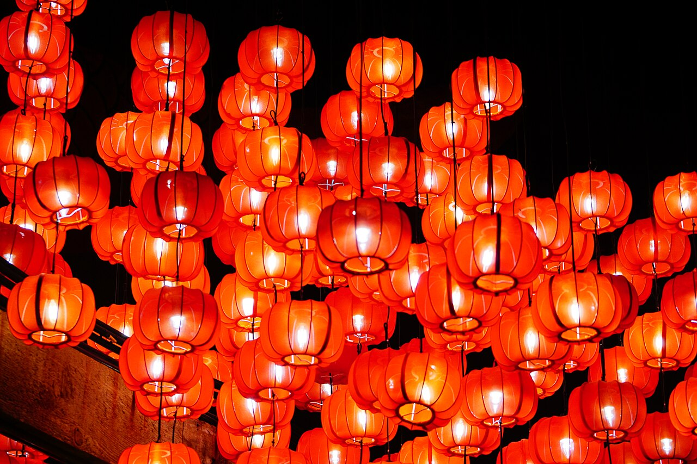

<div align="center">

# 🪔 FESTIVA 🎉

### Discover the world. Celebrate every culture. 🌍✨

*Every celebration has a story.*

[](https://festiva-eta.vercel.app)


   

</div>

---

## ✨ What is FESTIVA?

FESTIVA is a global guide to **festivals, traditions, food, attire, music and destinations** 🎊, with a **Matchmaker** that turns them into a personalised celebration plan 🗓️ and a **Gift Circle** that helps families and friends organise gift exchanges across languages 🎁.

🌏 **46 festivals** from **40 countries**, each with its history, meaning, traditions, etiquette and the next date, with a source for every movable date.

---

## 🧭 What you can do

| | Module | What it does |
|---|---|---|
| 🌍 | **Discover** | Search and filter festivals on a WebGL globe of festival lights |
| 🗺️ | **Journeys** | Countries and cities where celebrations come alive |
| 🍬 | **Taste** | Festival dishes and sweets, with diet and allergen notes |
| 👘 | **Wear** | Traditional dress, textiles and how to wear them |
| 🛍️ | **Shop** | Gift ideas by tier, from everyday to elite |
| 💌 | **Wishes** | Design a greeting card and share it |
| 🎮 | **Play** | Five cultural games |
| 🎶 | **Sound** | Music from sixteen genres around the world |
| 🤖 | **Intelligence** | Ask FESTIVA's cultural assistant |
| 💫 | **Matchmaker** | Six questions → a full plan: schedule, food, gifts, attire, music and a budget that adds up |
| 🎁 | **Gift Circle** | Invite people, capture wishes by voice or text in any language, draw Secret Santa, and track contributions |

---

## 🤝 Sponsor integrations, live and verified ✅

| Sponsor | How FESTIVA uses it | Status |
|---|---|---|
| 🗣️ **Sarvam AI** | Speech-to-text for voice wishes (`saaras:v4`), translation across Indian languages (`sarvam-translate:v1`), structured preferences and cultural suggestions (`sarvam-105b`) | ✅ **Live** |
| 🚩 **Flagsmith** | Ten server-enforced feature flags, remote configuration and an onboarding A/B experiment, all changeable with no redeploy | ✅ **Live** |
| 🐝 **NudgeBee** | Real alerts (latency, storage, voice failures, error rate) sent to NudgeBee's Event Webhook, plus approval-gated runbooks with an audit trail | ✅ **Live** (self-hosted Community edition) |

📄 Evidence report with real request IDs: [docs/evidence/integration-evidence-2026-11-21-live.md](docs/evidence/integration-evidence-2026-11-21-live.md)
🔍 Full details: [docs/SPONSORS.md](docs/SPONSORS.md)

---

## 🛠️ Built with

⚡ **Next.js 16** (App Router, Cache Components) · ⚛️ **React 19** · 🟦 **TypeScript** (strict) · 🎨 **Tailwind CSS 4** · 🌀 **Framer Motion** · 🌐 **Three.js + GLSL** · 🛡️ **Zod 4** · 🐘 **Supabase** (PostgreSQL, Auth, Row Level Security) · 🧪 **Jest + Playwright + axe-core**

🔒 Security headers and a Content-Security-Policy, server-only secrets, rate limiting, and every integration with an honest fallback.

---

## 🚀 Run it locally

```bash
npm ci
npm run dev        # 👉 http://localhost:3000
```

Production mode:

```bash
npm run build
npm run start
```

🧩 **No environment variables are needed.** FESTIVA runs in demo mode out of the box. To switch on the sponsor services, copy [`.env.example`](.env.example) to `.env.local` and fill in your own keys. 🔐 Never commit `.env.local`.

---

## ✅ Quality checks

```bash
npm run lint         # 🧹 ESLint
npm run typecheck    # 🟦 TypeScript
npm test             # 🧪 unit tests
npm run db:verify    # 🐘 database migrations and RLS on PGlite
npm run test:e2e     # 🎭 end-to-end tests in a real browser
```

---

## 📚 Documentation

| 📄 Doc | What's inside |
|---|---|
| [Architecture](docs/ARCHITECTURE.md) | How the app is put together |
| [Deployment](docs/DEPLOYMENT.md) | Vercel + Supabase step by step |
| [Windows setup](docs/WINDOWS_SETUP.md) | From an empty PC to FESTIVA running |
| [3-minute demo](docs/DEMO_3_MINUTES.md) | What to show judges |
| [Sponsors](docs/SPONSORS.md) | Sarvam AI, Flagsmith and NudgeBee in detail |
| [Testing](docs/TESTING.md) | What is tested and the results |
| [Known limitations](docs/KNOWN_LIMITATIONS.md) | What is honestly not done yet |

---

## 🙏 Credits

📸 Festival, food, attire and place photographs are from **Wikimedia Commons** under free licences (CC BY, CC BY-SA, CC0 or public domain). Each photo's author and licence is credited on its page and listed in [`src/data/photos.ts`](src/data/photos.ts).
🔤 Fonts: Bodoni Moda and Instrument Sans (self-hosted).
🎨 All other artwork is generated by FESTIVA's own code.

---

<div align="center">

### 👩‍💻 Made with 💛 by **Shambhavi M K**

[GitHub](https://github.com/ShambhaviCode) · [LinkedIn](https://www.linkedin.com/in/shambhavi-m-k-1b6677378/) · [X](https://x.com/heyshambhavi)

📄 MIT License · 🪔 Happy celebrating! 🎆

</div>
