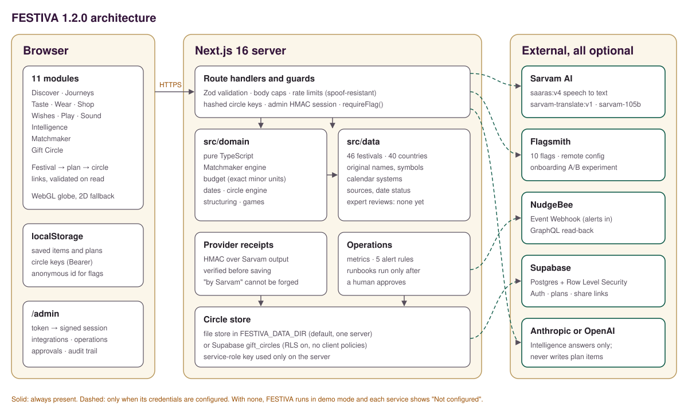
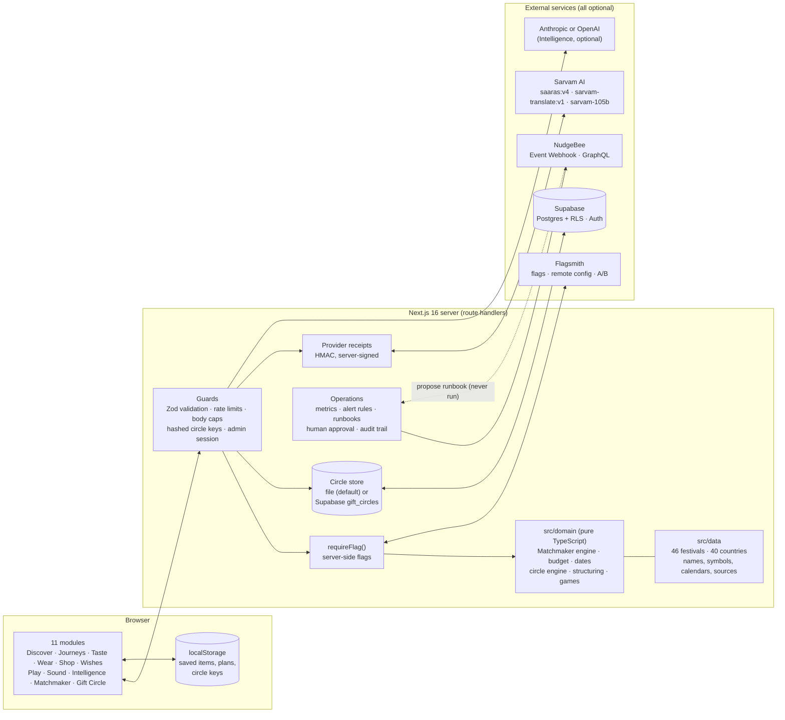
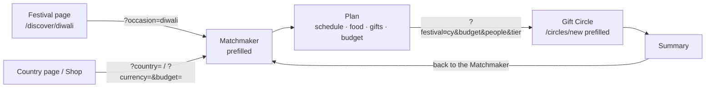

# Architecture

One Next.js application, one Supabase database, and a framework-free domain layer that a future native app can share. No microservices.



The same diagram as Mermaid (rendered by GitHub; in VS Code install a Mermaid preview extension):



Every arrow to an external service is optional. With nothing configured, FESTIVA runs in demo mode and each integration shows "Not configured".

## The connected journey (1.2)



Every value carried in a link is validated where it is read (`Matchmaker.tsx`, `Onboarding.tsx#fromLink`); unknown festivals, negative counts or unknown age groups are dropped, not trusted.

## Stack

| Concern | Choice | Note |
| --- | --- | --- |
| Framework | Next.js 16 (App Router, Turbopack, Cache Components) | Server components by default; client components only where there is interaction |
| Language | TypeScript, strict | |
| Styling | Tailwind CSS 4 with design tokens in `src/app/globals.css` | No component library; shadcn/ui was evaluated and not needed |
| Motion | Framer Motion (wizard steps, plan item changes), CSS (one homepage entrance) | Motion answers user actions; reduced motion is respected everywhere |
| 3D | Three.js with custom GLSL point and atmosphere shaders | Chosen over React Three Fiber: one scene, and direct control over disposal |
| Validation | Zod 4 | Matchmaker input, plans, API bodies, server environment, AI output |
| Backend | Supabase: PostgreSQL, Auth, Row Level Security | Optional at runtime |
| AI | Provider abstraction over Anthropic and OpenAI HTTP APIs | Optional at runtime; no SDK dependency |
| Tests | Jest, Playwright, axe-core, PGlite | |

GSAP, ScrollTrigger, liquid distortion and morphing cards were evaluated and left out: the design uses one orchestrated moment (the globe introduction) and keeps the rest quiet. Adding scroll-driven effects to every section would have cost performance without helping anyone do anything.

## Layers

```
src/domain   pure TypeScript      dates, budget, matchmaker, search, games, wishes, intelligence
src/data     curated dataset      typed constants; the single source of truth for the seed SQL
src/lib      platform             env, ai/, share-store, plans, store, analytics, rate-limit, http
src/app      routes               pages, API route handlers, metadata files
src/components UI
```

`src/domain` and `src/data` import nothing from React, Next.js or the DOM. That is deliberate: an Expo app can import them unchanged (see `MOBILE.md`).

## Rendering

- Catalogue pages are prerendered. Dynamic routes list every slug with `generateStaticParams`.
- Anything that depends on "today" (upcoming festivals, next dates) is computed in the browser from date rules, so prerendered HTML never contains a stale date.
- Pages that read server configuration (`/matchmaker`, `/intelligence`, `/plans/view`) call `connection()` inside a Suspense boundary, so they reflect the running deployment's environment rather than the build machine's.
- `/share/[token]` is rendered on demand inside Suspense.
- `src/proxy.ts` returns a real 404 for unknown catalogue slugs. Without it, Cache Components would stream a 200 shell before `notFound()` runs.

## The Matchmaker

`src/domain/matchmaker/engine.ts` is a deterministic, rules-based planner.

1. Input is validated with `matchmakerInputSchema`.
2. For each section, candidates are drawn from the curated dataset and scored by explicit rules (festival match, country match, dietary filters, audience, tier, interests, style). Each candidate carries the reason it qualified.
3. The top candidates are selected. Regeneration reshuffles within the best-scoring pool using a seeded generator, preferring items not currently shown.
4. The schedule is built from the chosen food and activities and the available time.
5. The budget is split by `src/domain/budget.ts`: integer minor units, largest-remainder allocation, so lines always add up exactly. Weights respond to stated interests and each adjustment is explained.

The same input always produces the same plan, which is what makes it testable. No AI is involved. When a provider is configured, `POST /api/matchmaker/concept` can rewrite only the introduction; items, schedule and budget are never produced by a model.

## AI

```
route handler → rate limit → Zod body validation → sanitise → provider.complete (timeout)
             → extract JSON → Zod output validation → strip URLs → reply
             ↘ any failure → grounded, non-AI answer with a notice
```

- Keys are read only in `src/lib/env.server.ts`, which no client component imports. An end-to-end test checks that no key names or provider endpoints appear in browser bundles.
- Prompt injection: user text is length-limited, stripped of control characters and wrapper tags, and passed inside delimited tags as data. The model has no tools and no secrets, and its output must match a schema. Links shown to people come only from FESTIVA's dataset.
- Logging records route, provider, outcome and duration. It never records questions or answers.
- With no credentials, `getProvider()` returns `null` and every caller uses its non-AI path. Nothing pretends to be AI.

## Data and persistence

| Mode | Saved items and plans | Share links | Accounts |
| --- | --- | --- | --- |
| Demo (no Supabase env) | Browser `localStorage` | In server memory, revocable with a private key | Off, and the UI says so |
| Supabase configured | `localStorage` plus the user's private rows | `shared_plans` rows, revocable by the owner | Supabase Auth |

The schema is in `supabase/migrations`. `supabase/seed.sql` is generated from `src/data`, so the database and the app cannot drift. See `DATA_PROVENANCE.md` for how sources and verification status are stored.

## Security

- Row Level Security on every table; verified by `npm run db:verify`.
- Shared plans are never selectable by anonymous clients. Public access is through `get_shared_plan(token)`, a `SECURITY DEFINER` function that returns one non-revoked snapshot.
- Share tokens are 144 random bits. URLs contain only the token.
- API routes validate bodies with Zod, cap body size and rate-limit by client.
- Security headers, including a Content-Security-Policy, are set in `next.config.ts`.
- No file uploads are accepted anywhere, so there is no upload surface to secure. Supabase Storage is not used.

## Internationalisation

- Dates and numbers use `Intl` with the visitor's chosen locale; all date arithmetic is in UTC calendar days.
- Budgets are stored in integer minor units with per-currency digit counts (INR 2, JPY 0, …). FESTIVA never converts between currencies.
- Festival dates are modelled by rule type (fixed, weekday rule, Easter offset, custom rule, sourced lunar table, seasonal), not as a single date column.
- Greetings carry their language. Wishes composes messages in English, Hindi, Spanish and French.
- Interface text is English only. Strings are not yet extracted into message catalogues.

## Gift Circle and the sponsor integrations

```
Browser (organiser, participants)            FESTIVA server (Next.js route handlers)                    External
───────────────────────────────              ──────────────────────────────────────────                   ────────
/circles, /circles/[id], /me, /summary  ──►  /api/circles/*  ─ instrument() ─ metrics.ts ─────────────► Prometheus (scrape /api/ops/metrics)
  keys in localStorage (Bearer)              │  authorise(): hash-compare organiser/participant keys
  anonymous id (x-festiva-anon)              │  requireFlag(): server-side flag enforcement
  useFlags(): GET /api/flags every 10 s      │  domain/circle/*: pure logic (engine, structure, suggestions)
                                             │  circles/repository.ts: file store │ Supabase gift_circles (RLS, server only)
                                             │
                                             ├─ integrations/sarvam.ts ─────────────────────────────────► Sarvam AI (STT, translate, chat)
                                             ├─ integrations/flagsmith.ts (official SDK, local evaluation) ► Flagsmith (environment document, events)
                                             └─ ops/alerts.ts ─ every 30 s ─ integrations/nudgebee.ts ───► NudgeBee Event Webhook / GraphQL
/admin/integrations, /admin/operations  ──►  /api/admin/*  (admin-auth.ts: token → HMAC session cookie)
                                             ops/runbooks.ts: propose → approve (human) → execute → audit.ts
NudgeBee workflow (HTTP task) ──────────►  /api/ops/runbook-proposals (propose only)
```

Layers stay as before: `src/domain/circle` and `src/domain/languages.ts` are framework-free; provider code lives only in `src/lib/integrations`; route handlers are thin.

**Storage.** `CircleRepository` has two implementations. The file store (default) writes one JSON document per circle, atomically, serialised per file, under `FESTIVA_DATA_DIR`; it suits one server instance. The Supabase store writes `public.gift_circles` with the service-role key from the server only, with optimistic concurrency on a `version` column; the table has RLS enabled and no client policies (`supabase/migrations/20261117000000_gift_circles.sql`, checked by `npm run db:verify`). Integration status, alerts, proposals, the audit trail, operational switches and experiment events are JSON files in the same data directory.

**Access.** No accounts are needed. Creating a circle returns an organiser key; joining with an invitation returns a participant key. Keys and invitation tokens are 24 random bytes, shown once, stored as SHA-256 hashes, compared in constant time. Views are built per role in the domain (`organiserView` hides Secret Santa pairs; `participantView` exposes only the caller's own data and their recipient's).

**Flags.** Evaluated on the server for an anonymous identity (the browser's random id, hashed twice) and returned to the browser by `/api/flags`. Every route re-evaluates the flags it depends on, so turning a flag off disables the feature, not only its button. On any Flagsmith failure, defaults from `src/lib/flags/definitions.ts` apply.

**Operations.** `instrument()` wraps every Gift Circle, flags and admin route. Alert rules read in-memory samples; transitions create events with evidence, propose runbooks, and are sent to NudgeBee. Operational switches (voice paused, AI structuring paused) are read by the routes on every request.

## Cultural data model (1.2)

| Layer | File | Holds |
| --- | --- | --- |
| Festival | `src/data/festivals.ts` | Names, countries, region, communities, date rule and checked occurrences, history, significance, traditions, variations, etiquette, greetings, provenance |
| Culture | `src/data/festival-culture.ts` | Original-script names with BCP 47 tags, symbols and meanings, calendar-system description |
| Review | `src/data/reviews.ts` | `EXPERT_REVIEWS` (empty until a named expert reviews a page) and `CLAIM_KINDS` (documented history, belief and interpretation, community practice, guidance) |

`tests/unit/data-integrity.test.ts` enforces the rules: every festival has a culture entry, every language tag is valid, checked and projected dates cite sources, every review names its reviewer, and each region has coverage. Workflow: [CONTENT_REVIEW.md](CONTENT_REVIEW.md).

## Rate limiting and abuse controls (1.2)

`src/lib/rate-limit.ts` is an in-memory fixed-window limiter (one server instance; see KNOWN_LIMITATIONS). `clientKey()` takes the client address from a header only when the deployment says it can be trusted (`FESTIVA_TRUST_PROXY`: `vercel` uses `x-real-ip`; `1`, the default off Vercel, uses the last `X-Forwarded-For` hop; `none` ignores both), so a forged header cannot mint fresh limits. When the table is full, the oldest tenth of entries is evicted rather than everything.

| Surface | Limit |
| --- | --- |
| Voice transcription | 6 per minute per participant, 30 per hour per address |
| Translation, structuring | 20 per minute per participant, and 300 per hour per address |
| Failed circle-key attempts | 30 per minute per address, then 429 |
| Admin sign-in | Rate-limited and audited |
